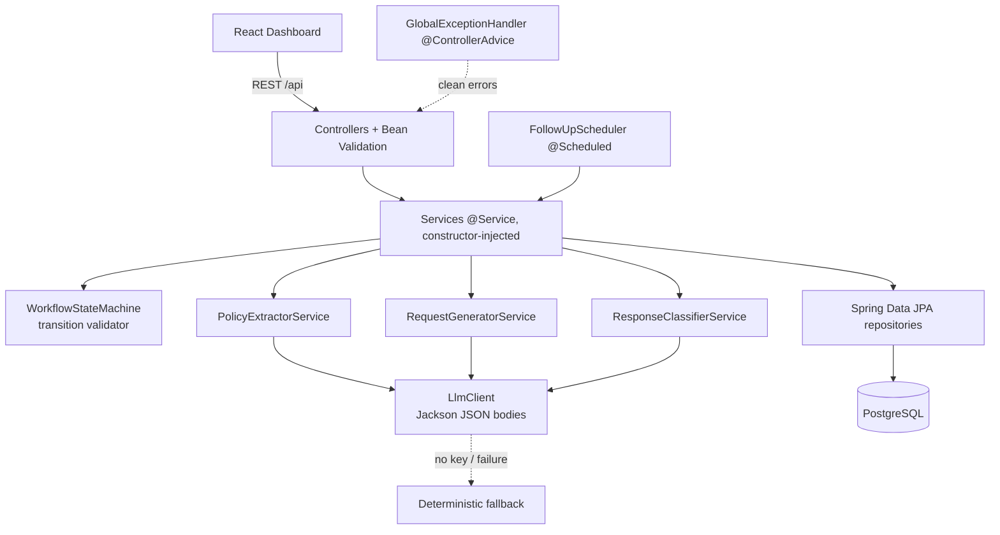
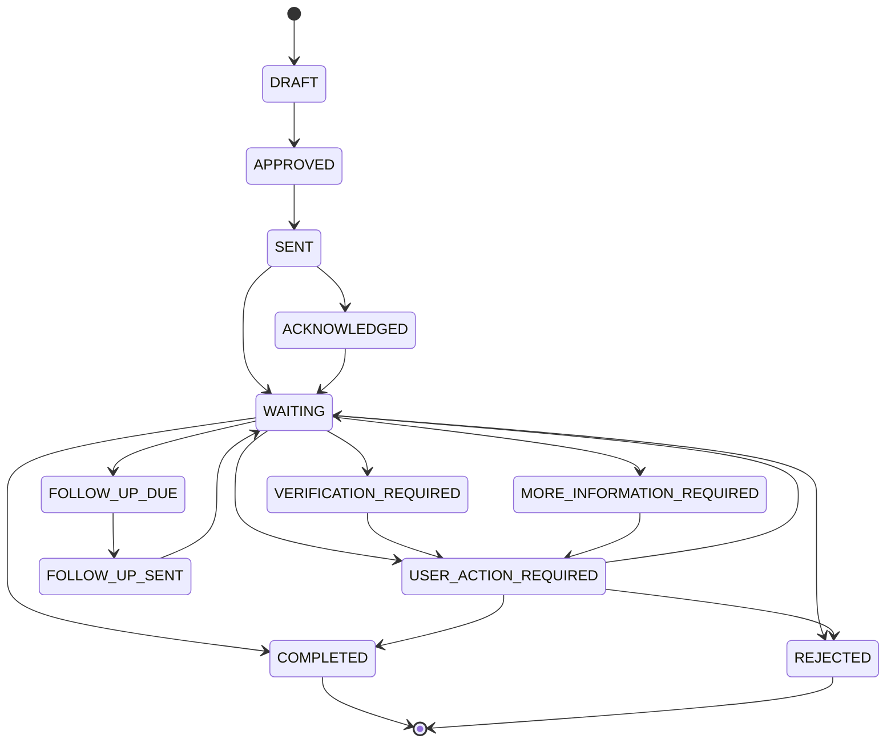

# PrivacyPilot

PrivacyPilot automates the **workflow** of requesting deletion of a user's
personal data from a **curated** list of companies. It automates: discovering a
company's deletion process, generating a personalized deletion request,
submitting it, monitoring and classifying the company's response, and following
up if needed.

> **Scope, stated plainly:** PrivacyPilot does **not** delete data from arbitrary
> third-party systems, and it does **not** guarantee the LLM's extraction or
> classification is 100% accurate. It automates *discovery, request
> generation/submission, response interpretation, and follow-up tracking*. A
> human must approve every request before it is sent.

---

## Table of Contents

- [Architecture](#architecture)
- [Workflow State Machine](#workflow-state-machine)
- [The Three AI Functions](#the-three-ai-functions)
- [Confidence-Based Fallback (key design decision)](#confidence-based-fallback-key-design-decision)
- [Data Model](#data-model)
- [REST API](#rest-api)
- [Setup & Run](#setup--run)
- [Evaluation: Methodology & Measured Results](#evaluation-methodology--measured-results)
- [Testing](#testing)
- [Limitations](#limitations)
- [Technologies Actually Used](#technologies-actually-used)

---

## Architecture

Single, clean Spring Boot application (a modular monolith — no microservices, no
message brokers, no external orchestration frameworks). The LLM is used only to
produce **structured JSON**, which is validated before it is allowed to affect
workflow state. Raw LLM text never drives a state transition directly.



Key architectural rules enforced in code:

| Rule | Where |
|------|-------|
| LLM output is validated against an expected shape before use | `ai/*Service.parse(...)` returns `Optional`, empty on malformed |
| LLM output is also checked for **semantic consistency**, not just shape | `ResponseClassifierService.isInconsistent(...)` downgrades contradictory results to human review |
| Malformed/absent LLM output never crashes a transition | services fall back to deterministic logic |
| Status changes go through a real state machine | `DeletionRequestService.transition(...)` calls `WorkflowStateMachine.validateTransition` |
| Concurrent transitions cannot silently overwrite each other | `@Version` optimistic lock on `DeletionRequest` → 409 on conflict |
| External email is never sent inside the DB transaction | transactional **outbox** (`OutboxEmail`) + `OutboxDeliveryWorker` deliver after commit |
| Sends and inbound processing are idempotent under retry/redelivery | unique outbox idempotency key; `(request_id, message_id)` dedupe on inbound |
| LLM request bodies built with a JSON library, not string concat | `llm/HttpLlmClient` uses Jackson `ObjectMapper` |
| DI everywhere; no `new` of domain services in controllers | all services are `@Service`/`@Component`, constructor-injected |
| Clean error responses, no stack traces | `web/GlobalExceptionHandler` |

## Workflow State Machine

Implemented as an explicit directed graph in `WorkflowStateMachine`, not a
free-form status string. Any transition not in the graph throws
`InvalidTransitionException` (surfaced as HTTP 409).



`COMPLETED` and `REJECTED` are terminal (no outgoing edges).

## The Three AI Functions

Each is its own `@Service` with a validated JSON contract. Each has a
deterministic fallback so the system works with **no API key** and never crashes
on bad model output.

1. **Policy → structured deletion info** (`PolicyExtractorService`)
   Returns `{ deletionSupported, deletionMethod, contact, requiredInformation[], responseDeadline }`.
   If the policy text contains **no** deletion/removal language, it returns
   `deletionSupported: false` rather than inventing a method or contact. (Tested:
   `PolicyExtractorServiceTest.policyWithNoDeletionLanguageReturnsNotSupported`.)

2. **Request generator** (`RequestGeneratorService`)
   Produces editable request text. The user must approve it (`POST /approve`)
   before it can be sent (`POST /send`) — never auto-sent.

3. **Response classifier** (`ResponseClassifierService`)
   Classifies an inbound reply into
   `RECEIVED | COMPLETED | VERIFICATION_REQUIRED | MORE_INFORMATION_REQUIRED | REJECTED | UNKNOWN`
   and extracts `{ referenceNumber, deadline, requiredAction, rejectionReason }`.
   It also returns a **`confidence` (0–1)** and an explicit **`ambiguous`** flag.

> **What "validated AI output" honestly means here.** The guarantee is **schema
> validation + semantic-consistency checks + an abstention policy** — *not*
> calibrated confidence. Two distinct steps run after the model responds:
> `parse(...)` rejects output that is malformed or has an out-of-enum category
> (→ deterministic fallback), and `isInconsistent(...)` downgrades output that is
> well-formed but self-contradictory (e.g. `COMPLETED` *with* a `requiredAction`,
> or `REJECTED` with no reason) to `ambiguous`, routing it to human review. The
> `confidence` number is the **model's own asserted** confidence; the code clamps
> it to `[0,1]` but does **not** claim it is a calibrated probability of
> correctness. The system's safety therefore comes from *abstention on
> uncertainty/inconsistency*, not from trusting the confidence value.

## Confidence-Based Fallback (key design decision)

This is the project's central design choice, and it is a deliberate
**precision-vs-recall tradeoff**.

When the classifier's confidence is below the configured threshold
(`privacypilot.classifier.confidence-threshold`, default **0.6**), **or** the
reply is flagged `ambiguous`, **or** the category is `UNKNOWN`, the workflow does
**not** force the reply into one of the six categories. Instead
(`DeletionRequestService.processInboundEmail`):

- the request goes to **`USER_ACTION_REQUIRED`** with
  `next_action = "AI uncertain — needs human review"`, and
- the **raw LLM output and the confidence value** are stored on the
  `email_messages` row (`raw_llm_output`, `classification_confidence`) so a human
  reviewer can see exactly why it was flagged.

Genuine uncertainty uses the **direct** `WAITING → USER_ACTION_REQUIRED` edge and
records an accurate `review_reason` on the request (e.g. *"AI flagged the reply
as ambiguous or conflicting"* or *"AI confidence below threshold"*). It is
**never** routed through `VERIFICATION_REQUIRED` — that state is reserved for the
case where the company *actually* asked for identity verification, so the audit
trail never conflates "the reply was vague" with "the company demanded ID".

**What this buys and what it costs:**

- **Gain (precision):** no silent wrong guesses. A reply we are unsure about is
  never auto-marked COMPLETED or REJECTED — the two most consequential states.
- **Cost (recall):** fewer replies are auto-classified end-to-end; some cases a
  perfect model *could* have resolved are instead sent to a human.

This is the same philosophy a mature system uses when a component states what it
does and does **not** guarantee: PrivacyPilot guarantees it will not silently act
on a low-confidence interpretation; it does not guarantee it will fully automate
every reply.

Tested in `DeletionRequestServiceTest`:
`lowConfidenceReplyRoutesToHumanReview` and
`ambiguousFlagRoutesToHumanReviewEvenWithHighConfidence`.

## Correctness Under Failure, Retries & Concurrency

The AI path is deliberately conservative; the surrounding workflow is held to the
same standard. Three distributed-systems hazards are addressed explicitly.

### 1. Email is an irreversible side effect → transactional outbox

`@Transactional` cannot make a database commit and an external email atomic. If
the email were sent inline and the transaction later rolled back, the company
would have received a request the DB has no record of (or a retry would email
twice). So sending is split:

```
APPROVED ──(one DB txn)──▶ status change + OutboxEmail(PENDING, idempotency key)
                                   │  commit
                                   ▼
                        OutboxDeliveryWorker (after commit)
                                   │
                                   ▼
                         EmailSender → provider ; mark SENT / retry / FAILED
```

`DeletionRequestService.send()` and `followUp()` only write DB state plus a
durable `OutboxEmail` row — **no email is sent inside the transaction**. A
rollback discards both together, so the DB never disagrees with what was actually
sent. `OutboxDeliveryWorker` (a `@Scheduled` poller) delivers after commit and is
idempotent: an already-`SENT` row is skipped, failures retry up to a cap, then go
`FAILED` for operator attention.

### 2. Retries must not duplicate work → idempotency keys

- **Outbound:** each logical send has a deterministic key
  (`deletion-request-{id}-initial`, `…-followup-{n}`). `send()`/`followUp()` skip
  enqueue if the key already exists, so retrying the operation cannot enqueue a
  second email. (Tested: `sendDoesNotDoubleEnqueueWhenKeyAlreadyExists`.)
- **Inbound:** `processInboundEmail` returns the existing row (and performs no
  second transition) if a message with the same `(requestId, messageId)` was
  already processed — duplicate webhook delivery is a no-op. Backstopped by a
  `UNIQUE(request_id, message_id)` DB constraint. (Tested:
  `duplicateInboundMessageIsIdempotentNoSecondTransition`.)

### 3. Concurrent transitions must not clobber each other → optimistic locking

The state machine only validates against the state a thread *read*. Two events
that both read `WAITING` would both pass validation. `DeletionRequest` therefore
carries an `@Version`: the second transaction to commit fails with an optimistic-
lock exception (surfaced as **HTTP 409 Concurrent modification**) instead of
silently overwriting the first. The losing caller retries against fresh state.

**Multi-instance safety.** The outbox worker is safe to run on multiple app
instances. Claims use a native `UPDATE … WHERE id IN (SELECT id … FOR UPDATE SKIP
LOCKED …) RETURNING *`, so two workers never grab the same row. Each claim stamps a
fresh `claim_token`; finalization (`markSent`/`markFailure`) is a conditional
`UPDATE … WHERE id = ? AND status = 'PROCESSING' AND claim_token = ?`. If a
worker's lease expires and another worker reclaims the row, the original worker's
late finalize matches zero rows and is a no-op — it can never overwrite the new
claimant's outcome. The one remaining honest limitation is a possible **duplicate
SEND to the mail provider** (at-least-once), not incorrect state, and would only be
removed by a provider that honors a caller idempotency key (SMTP does not).

## Data Model

- `users`: id, name, email, phone, address
- `companies`: id, name, privacy_policy_url, deletion_method, privacy_email, required_information, instructions
- `deletion_requests`: id, **version**, user_id, company_id, status, created_at, updated_at, last_action, next_action, follow_up_due_at, **follow_up_count**, request_body, review_reason
- `email_messages`: id, request_id, message_id, direction, subject, body, timestamp, classification, extracted_info, raw_llm_output, classification_confidence — `UNIQUE(request_id, message_id)`
- `outbox_emails`: id, idempotency_key (unique), request_id, sender, recipient, subject, body, status (PENDING/PROCESSING/SENT/FAILED), attempts, claimed_at, claimed_by, claim_token, last_error, created_at, sent_at

15 companies are seeded at startup by `CompanySeeder` (idempotent).

## REST API

| Method & Path | Purpose |
|---------------|---------|
| `POST /api/users` | Create a user |
| `GET /api/companies` | List seeded companies |
| `POST /api/companies/analyze` | Analyze a privacy policy → structured deletion info |
| `POST /api/requests` | Create a deletion request (DRAFT + generated body) |
| `GET /api/requests` | List all requests (dashboard data) |
| `GET /api/requests/{id}` | Get one request |
| `POST /api/requests/{id}/approve` | Approve (DRAFT → APPROVED) |
| `POST /api/requests/{id}/send` | Send (APPROVED → SENT → WAITING) |
| `POST /api/requests/{id}/follow-up` | Trigger a follow-up |
| `POST /api/emails/process` | Feed an inbound reply into the classifier + workflow |

## Setup & Run

### Option A — Docker Compose (app + Postgres + dashboard)

```bash
docker compose up --build
```

- Backend API: http://localhost:8080
- Dashboard: http://localhost:5173
- Postgres: localhost:5432 (db/user/pass: `privacypilot`)

No LLM key is required — the app runs in deterministic offline fallback mode. To
use a real LLM, set `LLM_API_KEY` (and optionally `LLM_PROVIDER`, `LLM_MODEL`);
see `.env.example`.

### Option B — Backend tests without a local JDK 17

The build targets Java 17. If your host JDK differs, build/test in Docker:

```bash
docker run --rm -v "$PWD":/app -v "$HOME/.m2":/root/.m2 \
  -w /app maven:3.9-eclipse-temurin-17 mvn -B test
```

### Quick end-to-end (offline) demo

```bash
# 1. create a user
curl -s localhost:8080/api/users -H 'Content-Type: application/json' \
  -d '{"name":"Jane Doe","email":"jane@example.com"}'
# 2. list companies, pick an id, create a request
curl -s localhost:8080/api/companies
curl -s localhost:8080/api/requests -H 'Content-Type: application/json' \
  -d '{"userId":1,"companyId":1}'
# 3. approve + send
curl -s -X POST localhost:8080/api/requests/1/approve
curl -s -X POST localhost:8080/api/requests/1/send
# 4. simulate an ambiguous reply -> routed to human review
curl -s localhost:8080/api/emails/process -H 'Content-Type: application/json' \
  -d '{"requestId":1,"subject":"Re","body":"We will be in touch at some point."}'
```

## Evaluation: Methodology & Measured Results

The eval set is **hand-labeled** and lives in `eval/`. `eval/run_eval.py`
re-implements the **exact deterministic fallback + routing rules** used by the
Java services and reports accuracy, a confusion matrix, and the specific items it
got wrong. Results are written to `eval/results.json` (committed).

> **What these numbers measure:** the *deterministic offline fallback* — i.e. the
> behavior that ships with **no LLM API key**, which is fully reproducible by
> anyone with no network access. This is the guaranteed baseline, not a claim
> about a specific LLM's accuracy.

Reproduce:

```bash
python3 eval/run_eval.py
```

### Policy extractor — 15/15 correct (accuracy **100.00%**, F1 **1.00**)

8 policies that support deletion, 7 that do not (including cookie/analytics
policies with no deletion language, and one that *mentions* deletion but
explicitly refuses it — the negation guard handles that). On this hand-labeled
set the detector gets all 15 right (`tp=8, tn=7, fp=0, fn=0`).

### Response classifier — 14/16 correct (accuracy **87.50%**)

16 replies spanning all six categories, including four deliberately
ambiguous/conflicting replies whose ground-truth label is `UNKNOWN` (they *should*
be routed to human review). Confusion matrix (rows = expected, cols = predicted),
from `eval/results.json`:

```
expected \ pred | RECEIV COMPLE VERIFI MORE_I REJECT UNKNOW
RECEIVED        |      3      0      0      0      0      1
COMPLETED       |      0      2      0      0      0      1
VERIFICATION_RE |      0      0      2      0      0      0
MORE_INFORMATIO |      0      0      0      2      0      0
REJECTED        |      0      0      0      0      2      0
UNKNOWN         |      0      0      0      0      0      3
```

**The two it got wrong — and why they fail *safely*:**

- `rep-15` — *"We have processed your request and your profile no longer exists
  on our platform."* Expected `COMPLETED`, predicted `UNKNOWN`. The deterministic
  detector keys on words like "deleted/erased"; "profile no longer exists" uses
  none of them, so it has no signal and abstains.
- `rep-16` — *"We have received your request. We cannot give you an exact
  completion date yet…"* Expected `RECEIVED`, predicted `UNKNOWN`. It contains both
  a "received" signal and a "cannot" (rejection) signal — conflicting — so the
  rule abstains.

Both misses land in `UNKNOWN` → **human review**, not a wrong confident answer.
That is the precision/recall tradeoff working as designed: the classifier gives
up recall on genuinely hard cases rather than risk a wrong COMPLETED/REJECTED. A
stronger LLM (when a key is configured) would be expected to resolve `rep-15`; the
`rep-16` conflict is exactly the kind of case a human *should* see.

## Testing

49 JUnit 5 / Mockito tests. Run with the Docker command above.

- `WorkflowStateMachineTest` — legal happy-path and branch transitions, illegal
  jumps throwing `InvalidTransitionException`, terminal states, direct
  `WAITING → USER_ACTION_REQUIRED` uncertainty edge.
- `PolicyExtractorServiceTest` — no-deletion-language → not supported; explicit
  negation ("we do not delete") → not supported; no invented method when the text
  evidences none; WEB_FORM inferred only when evidenced; valid/malformed/wrong-
  type/prose-wrapped JSON parsing.
- `RequestGeneratorServiceTest` — template fallback content; JSON parsing.
- `ResponseClassifierServiceTest` — clear/ambiguous/conflicting replies; missing
  confidence treated as ambiguous; invalid category and malformed JSON rejected;
  confidence clamped; **semantic-consistency downgrades** (COMPLETED+requiredAction,
  REJECTED-without-reason, VERIFICATION-without-action → ambiguous).
- `DeletionRequestServiceTest` — confidence/ambiguity routing to
  `USER_ACTION_REQUIRED` with accurate `review_reason`; confident
  COMPLETED/REJECTED transitions; **outbox enqueue instead of inline send**;
  **idempotent enqueue** on retry; **follow-up idempotency keying**; **duplicate
  inbound message is a no-op**.
- `OutboxDeliveryWorkerTest` — success marks SENT; transient failure stays PENDING
  for retry; failure at max attempts marks FAILED.
- `FollowUpSchedulerTest` — processes each due request; a single failure does not
  stop the others.

## Limitations

- **Does not delete data from arbitrary third-party systems.** It only supports
  the curated, seeded companies and automates the request/response workflow.
- **Does not guarantee LLM extraction/classification is 100% accurate.** The
  committed eval shows a concrete miss rate; the design deliberately routes
  uncertain cases to a human instead of guessing.
- **Human approval is required before any request is sent.** There is no
  auto-send path.
- The default eval numbers measure the **deterministic fallback**, not a specific
  LLM. Inbound email is fed via `POST /api/emails/process` (a simulated intake);
  a production IMAP/webhook ingestion is out of scope for this build.
- The classifier's `confidence` is **model-asserted, not calibrated**. Safety
  comes from abstaining on low confidence / ambiguity / self-inconsistency, not
  from treating the number as a true probability of correctness.
- The transactional-outbox worker is **multi-instance safe**: rows are claimed with
  `FOR UPDATE SKIP LOCKED` (no two workers claim the same row) and finalization is
  fenced by a per-claim `claim_token`, so a stale worker cannot overwrite a
  reclaimed row's outcome. The remaining honest limitation is a possible
  **duplicate SEND** to the mail provider (at-least-once delivery), because SMTP
  via `JavaMailSender` offers no idempotency key — not incorrect state.
- Prompts are assembled from curated company metadata; there is **no hardened
  defense against prompt injection** if untrusted policy text were ever fed into a
  generation prompt. Acceptable only because the company set is curated.

## Technologies Actually Used

Java 17, Spring Boot 3.3 (Web, Data JPA, Validation, Mail), PostgreSQL, Jackson,
Spring Scheduler, JUnit 5 + Mockito, React 18 + Vite, Docker + Docker Compose,
Python 3 (eval only). No Kubernetes, Kafka, Redis, MongoDB, vector DBs, agent
frameworks, or microservices.
