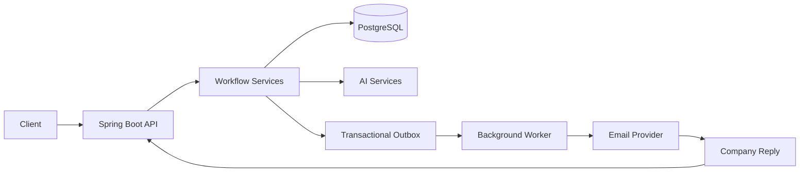

# PrivacyPilot — Privacy Request Workflow Automation

PrivacyPilot is a Java/Spring Boot application that automates privacy and data-deletion request workflows.

It helps manage the full flow: create a request, prepare and approve the request, send it, process company replies, handle follow-ups, and send unclear cases to human review.

## Why I built it

The interesting part of this project is **reliable workflow processing**.

A real request can involve:
- delayed replies
- duplicate messages
- multiple workers
- failed workers
- concurrent updates
- uncertain AI classifications

The project is designed so these situations do not silently corrupt the workflow.

## Architecture



## Tech Stack

- **Java 17**
- **Spring Boot**
- **Spring Web**
- **Spring Data JPA / Hibernate**
- **PostgreSQL**
- **React + Vite**
- **LLM API** for selected classification/generation tasks
- **Maven**
- **Docker / Docker Compose**
- **JUnit / Mockito / Testcontainers**

## How the workflow works

```text
Create request
      ↓
Review / approve
      ↓
Send request
      ↓
Wait for company response
      ↓
Classify response
      ↓
 ┌───────────────┐
 │ Clear result? │
 └───────┬───────┘
     Yes │    No
         │     └──→ Human review
         ↓
Update workflow
         ↓
Follow-up / Complete / Reject
```

The workflow uses an explicit state machine instead of allowing arbitrary status changes.

## Important Design Decisions

### 1. Transactional Outbox

Sending an email is an external action, so it should not happen directly inside the database transaction.

Instead:

```text
Database transaction
    ↓
Update request + create outbox event
    ↓
Commit
    ↓
Background worker sends email
```

This keeps the database state and pending email work consistent.

### 2. Multiple Workers

More than one worker can process pending outbox jobs.

PostgreSQL `SKIP LOCKED` allows workers to pick different jobs without waiting for rows another worker is already processing.

### 3. Idempotency

The same operation can be received more than once because retries and duplicate deliveries are normal in distributed systems.

The project uses idempotency keys and database constraints so the same logical email/request is not processed twice.

### 4. Optimistic Locking

Two requests can try to change the same workflow at the same time.

The `@Version` field on the request detects conflicting updates instead of silently allowing one update to overwrite another.

### 5. Worker Leases and Fencing

A worker can fail after claiming a job.

The system uses a claim/lease mechanism so another worker can recover the job.

A claim token is checked when the worker finishes. This prevents an old worker from overwriting the result after another worker has taken ownership.

## AI Usage

AI is used for selected tasks such as:

- extracting useful information from company policies
- generating request text
- classifying company responses

The AI is **not allowed to freely control the workflow**.

The application validates the returned structure and uses deterministic fallback logic when the model response is missing or invalid.

### Human review

If a response is unclear, ambiguous, or below the configured confidence threshold, the system sends it to human review instead of forcing an incorrect workflow decision.

This is an intentional **precision-over-recall** choice: it is better to ask a human than silently mark a request as completed or rejected incorrectly.

## Testing

The project includes tests for important workflow and reliability behavior, including:

- workflow state transitions
- AI fallback behavior
- low-confidence classification
- duplicate inbound messages
- duplicate outbound operations
- optimistic locking
- outbox processing
- concurrent worker behavior

## What is interesting about this project

The main engineering challenge was not building CRUD APIs.

It was making an **asynchronous, AI-assisted workflow reliable when things go wrong**.

The key ideas are:

**Transactional Outbox + Idempotency + Optimistic Locking + Worker Recovery + Human Review**

## Running locally

The repository includes Docker configuration and an `.env.example` file for local setup.

Do not add real API keys, passwords, production database credentials, or private company information to the repository.
